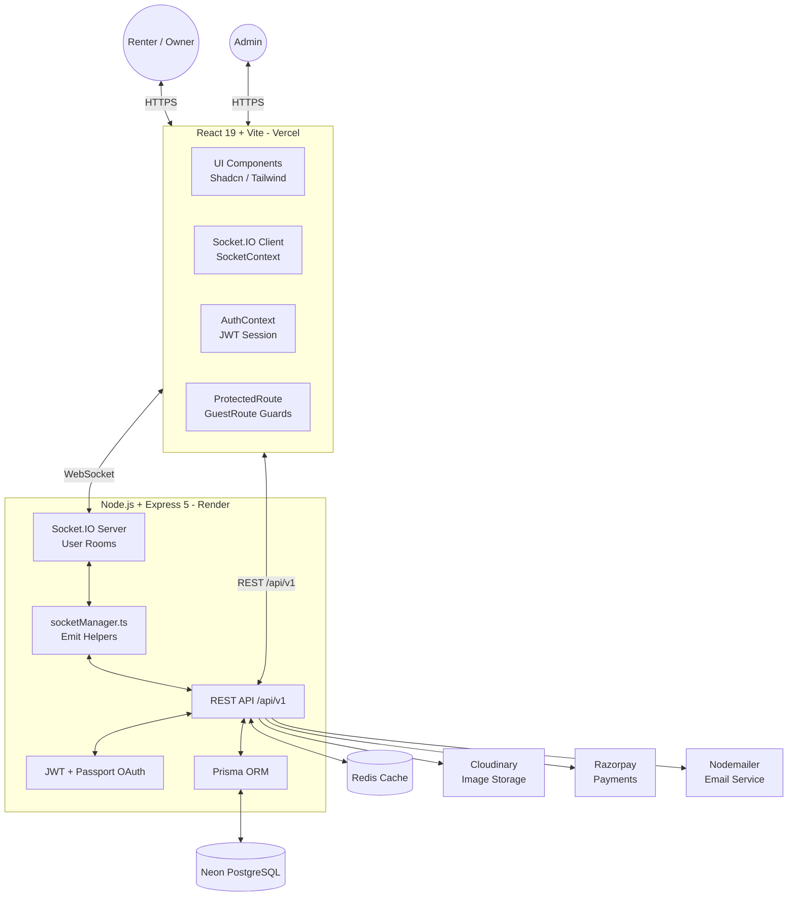
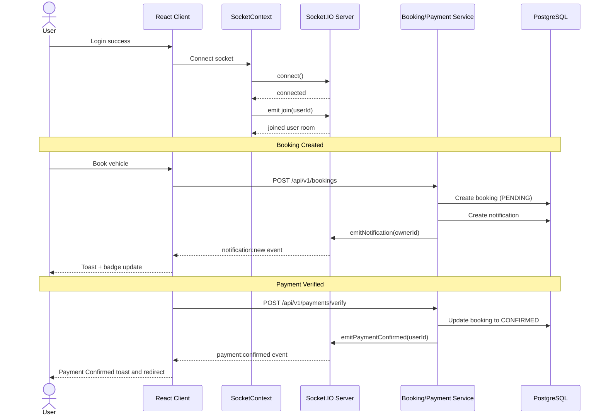
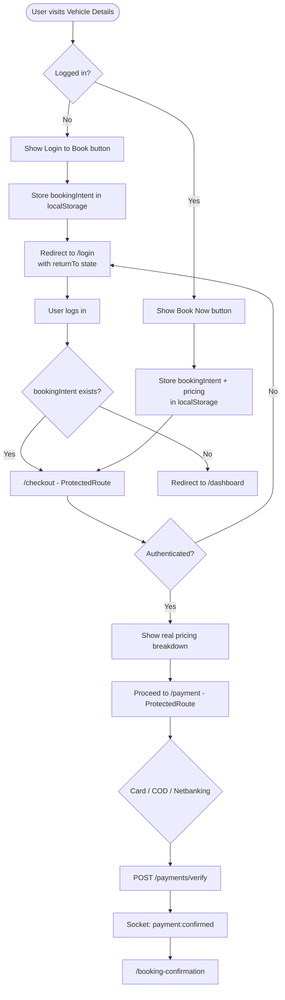
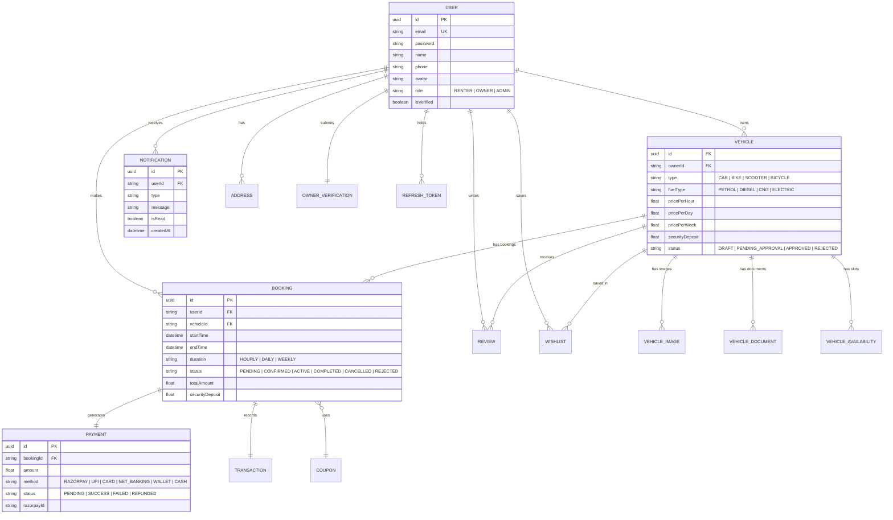

# 🚗 CarBoom

<div align="center">

**CarBoom** is a modern **peer-to-peer vehicle rental marketplace** that enables users to rent and list Cars, Bikes, Scooters, Bicycles & EVs — for durations ranging from **1 hour to 1 week**. Built for **Tier-2 and Tier-3 cities in India**.

<a href="https://github.com/Piyush200516/CarBoom"></a>
<a href="https://opensource.org/licenses/MIT"></a>
<a href="https://nodejs.org"></a>
<a href="https://react.dev"></a>
<a href="https://neon.tech"></a>
<a href="https://socket.io"></a>
<a href="https://www.typescriptlang.org"></a>

</div>

---

## 🚀 What is CarBoom?

CarBoom is a next-generation **peer-to-peer vehicle rental platform** where:

- 🚗 **Renters** can search, browse, and instantly book vehicles with a protected, guided checkout flow.
- 🏠 **Owners** can list their vehicles, manage availability, and earn passive income.
- 🛡️ **Admins** can verify owners, approve vehicles, and manage the entire ecosystem.

### ✨ Key Highlights

| Feature | Description |
|---|---|
| 🔌 Real-Time Notifications | Live Socket.IO events for bookings, payments & status changes |
| 🔒 Protected Booking Flow | Login required to book — with seamless post-login redirect |
| 💳 Payments | Razorpay integration with coupon & discount support |
| 🔐 Auth & RBAC | JWT + Refresh Token auth with role-based access control |
| 🔔 Notification Bell | Real-time bell with unread badge, dropdown panel & DB sync |
| ⭐ Reviews & Ratings | User reviews per vehicle (after completed booking only) |
| 📊 Owner Dashboard | Revenue analytics & booking management |
| 📍 Location Services | City-based vehicle search & delivery options |
| 🤖 AI Recommendations | Smart vehicle suggestions based on preferences *(planned)* |
| ❤️ Wishlist | Save favourite vehicles |
| 🔑 OAuth | Google & GitHub social login |
| 📧 Email | Nodemailer for transactional emails |
| 🛡️ Security | Helmet, Rate Limiting, CORS, Audit Logs |
| 📄 API Docs | Swagger / OpenAPI documentation |
| 📱 Responsive UI | Fully responsive with dark mode & glassmorphism design |

---

## 🛠️ Tech Stack

### Frontend (`/client`)

| Technology | Purpose |
|---|---|
| React 19 + TypeScript | Core UI framework |
| Vite 8 | Build tool & dev server |
| Tailwind CSS v4 | Utility-first styling |
| Shadcn UI + Base UI | Pre-built component library |
| React Router DOM v7 | Client-side routing with `ProtectedRoute` guards |
| Redux Toolkit | Global state management |
| TanStack Query v5 | Server state & data fetching |
| React Hook Form + Zod | Form handling & validation |
| Framer Motion | Animations & transitions |
| Axios | HTTP client with token-refresh interceptor |
| Socket.IO Client | Real-time WebSocket communication |
| Lucide React | Icon library |
| Sonner | Toast notifications |
| Dayjs | Date utilities |

### Backend (`/server`)

| Technology | Purpose |
|---|---|
| Node.js + Express 5 | REST API server |
| TypeScript | Type-safe backend |
| Prisma ORM | Database access layer |
| Neon PostgreSQL | Serverless PostgreSQL database |
| Socket.IO Server | Real-time WebSocket events (user rooms) |
| Redis | Caching & session store |
| JWT (Access + Refresh) | Authentication tokens |
| Passport.js | Google & GitHub OAuth |
| Cloudinary | Image & document storage |
| Razorpay | Payment gateway (with HMAC verification) |
| Nodemailer | Transactional email |
| Multer | File upload handling |
| Winston + Morgan | Structured logging |
| Helmet | HTTP security headers |
| express-rate-limit | Rate limiting |
| Swagger / OpenAPI | API documentation (`/api-docs`) |
| Zod | Request validation |

---

## 📊 System Architecture

### 1. High-Level Architecture



### 2. Real-Time Architecture (Socket.IO)



### 3. Protected Booking Flow



### 4. Database Entity Relationship (ER) Diagram



### 5. Jenkins CI/CD Pipeline


---

## 📁 Project Structure

```text
CarBoom/
├── client/                         # React 19 + Vite Frontend
│   ├── src/
│   │   ├── components/
│   │   │   ├── ui/
│   │   │   │   ├── NotificationBell.tsx   # Real-time notification bell
│   │   │   │   ├── NotificationBell.css
│   │   │   │   ├── Toast.tsx
│   │   │   │   ├── Button.tsx
│   │   │   │   ├── Card.tsx
│   │   │   │   ├── Modal.tsx
│   │   │   │   └── ...
│   │   │   ├── layout/
│   │   │   │   ├── DashboardNavbar.tsx    # NotificationBell integrated
│   │   │   │   ├── Navbar.tsx
│   │   │   │   └── Footer.tsx
│   │   │   ├── common/
│   │   │   ├── auth/
│   │   │   ├── dashboard/
│   │   │   └── home/
│   │   ├── pages/
│   │   │   ├── Home/
│   │   │   ├── BrowseVehicles/
│   │   │   ├── VehicleDetails/            # Auth guard + bookingIntent save
│   │   │   ├── Checkout/                  # ProtectedRoute + localStorage pricing
│   │   │   ├── Payment/                   # ProtectedRoute + real-time confirm
│   │   │   ├── BookingConfirmation/       # ProtectedRoute
│   │   │   ├── Dashboard/
│   │   │   │   ├── DashboardHome.tsx
│   │   │   │   ├── MyBookings.tsx
│   │   │   │   └── Wishlist.tsx
│   │   │   ├── Profile/
│   │   │   ├── Login/                     # returnTo redirect after login
│   │   │   ├── Signup/
│   │   │   ├── ForgotPassword/
│   │   │   ├── ResetPassword/
│   │   │   ├── BecomeOwner/
│   │   │   ├── HowItWorks/
│   │   │   ├── AboutUs/ & Contact/
│   │   │   ├── HelpCenter/
│   │   │   ├── Safety/ & Privacy/ & Terms/
│   │   │   ├── CancellationPolicy/
│   │   │   └── NotFound/
│   │   ├── services/
│   │   │   ├── authService.ts
│   │   │   ├── bookingService.ts          # Full booking API wrapper
│   │   │   ├── paymentService.ts          # Payment API wrapper
│   │   │   ├── reviewService.ts           # Review API wrapper
│   │   │   └── profileService.ts
│   │   ├── store/
│   │   │   ├── AuthContext.tsx            # JWT session + forced logout
│   │   │   └── SocketContext.tsx          # Socket.IO client context
│   │   ├── router/
│   │   │   └── AppRoutes.tsx              # GuestRoute + ProtectedRoute guards
│   │   ├── layouts/
│   │   │   ├── MainLayout.tsx
│   │   │   └── DashboardLayout.tsx
│   │   ├── utils/
│   │   │   ├── api.ts                     # Axios + token refresh interceptor
│   │   │   └── cn.ts
│   │   └── data/
│   │       └── mockData.ts
│   ├── vite.config.ts
│   └── package.json
│
├── server/                         # Node.js + Express 5 Backend
│   ├── src/
│   │   ├── controllers/
│   │   │   ├── auth.controller.ts
│   │   │   ├── user.controller.ts
│   │   │   ├── vehicle.controller.ts
│   │   │   ├── booking.controller.ts
│   │   │   ├── payment.controller.ts      # Razorpay order + verify
│   │   │   ├── review.controller.ts
│   │   │   └── notification.controller.ts
│   │   ├── routes/
│   │   │   ├── auth.routes.ts
│   │   │   ├── user.routes.ts
│   │   │   ├── vehicle.routes.ts
│   │   │   ├── booking.routes.ts
│   │   │   ├── payment.routes.ts
│   │   │   ├── review.routes.ts
│   │   │   ├── notification.routes.ts
│   │   │   └── index.ts                   # All routes registered
│   │   ├── repositories/
│   │   │   ├── booking.repository.ts
│   │   │   ├── vehicle.repository.ts
│   │   │   ├── review.repository.ts
│   │   │   ├── notification.repository.ts
│   │   │   ├── availability.repository.ts
│   │   │   ├── token.repository.ts
│   │   │   └── user.repository.ts
│   │   ├── services/
│   │   │   ├── auth.service.ts
│   │   │   ├── booking.service.ts         # Real-time events on status change
│   │   │   ├── payment.service.ts         # Real-time payment confirmation
│   │   │   ├── review.service.ts
│   │   │   ├── vehicle.service.ts
│   │   │   └── storage.service.ts
│   │   ├── lib/
│   │   │   └── socketManager.ts           # Socket.IO singleton + emit helpers
│   │   ├── middleware/
│   │   │   ├── auth.middleware.ts
│   │   │   ├── error.middleware.ts
│   │   │   ├── rateLimit.middleware.ts
│   │   │   ├── role.middleware.ts
│   │   │   ├── upload.middleware.ts
│   │   │   └── validator.middleware.ts
│   │   ├── config/
│   │   │   ├── config.ts                  # Zod-validated env
│   │   │   ├── db.ts
│   │   │   ├── logger.ts
│   │   │   └── cloudinary.ts
│   │   ├── utils/
│   │   │   ├── apiError.ts
│   │   │   ├── apiResponse.ts
│   │   │   └── asyncHandler.ts
│   │   ├── validators/
│   │   ├── types/
│   │   ├── constants/
│   │   ├── app.ts                         # Express setup + CORS
│   │   └── server.ts                      # HTTP server + Socket.IO init
│   ├── prisma/
│   │   ├── schema.prisma
│   │   └── migrations/
│   └── package.json
│
├── Jenkinsfile                     # CI/CD Pipeline definition
└── README.md
```

---

## 🔌 Real-Time Features (Socket.IO)

CarBoom uses Socket.IO to push live events directly to users without page refresh.

### How It Works

1. **After login** — `SocketContext` connects and emits `join(userId)` to join a personal room.
2. **Server services** use `socketManager.ts` helpers to emit events after DB writes.
3. **Client listens** via `useSocket()` hook and updates the UI instantly.

### Events

| Event | Direction | Trigger | Description |
|-------|-----------|---------|-------------|
| `join` | Client → Server | After login | User joins personal socket room |
| `joined` | Server → Client | Ack | Confirms room membership |
| `notification:new` | Server → Client | Any notification created | Shows toast + increments bell badge |
| `booking:updated` | Server → Client | Booking status change | Refresh booking list UI |
| `payment:confirmed` | Server → Client | Payment verified | Show success toast + navigate |

### NotificationBell Component

- 🔔 **Live badge** — increments on every `notification:new` event
- 📋 **Dropdown panel** — merges Socket.IO live stream with DB history (REST API)
- ✅ **Mark all read** — calls `PATCH /api/v1/notifications/read-all` + clears badge
- 🎨 **Glassmorphism design** with animated slide-in panel

---

## 🔒 Auth & Route Protection

### Route Guards

| Guard | Used On | Behaviour |
|-------|---------|-----------|
| `GuestRoute` | `/login`, `/signup` | Redirects logged-in users to `/dashboard` |
| `ProtectedRoute` | `/checkout`, `/payment`, `/booking-confirmation`, `/dashboard/*` | Redirects guests to `/login` with `returnTo` state |

### Booking Intent Flow

When a **guest** tries to book:

```text
Vehicle Details → handleBooking()
  ↓ Not authenticated
  ↓ Save bookingIntent to localStorage
  ↓ navigate("/login", { state: { returnTo: vehicleUrl } })

Login page → onSubmit()
  ↓ Login success
  ↓ bookingIntent exists? → navigate("/checkout")
  ↓ else → navigate(returnTo) or "/dashboard"
```
<p align="center">
  
  
  
</p>
```
This ensures the **booking intent is never lost** even when the user is not logged in.

---

## 🔌 API Reference

Base URL (Local): `http://localhost:5000/api/v1`  
Base URL (Production): `https://carboom-backend.onrender.com/api/v1`  
API Docs (Swagger): `http://localhost:5000/api-docs`

### Auth Routes — `/api/v1/auth`

| Method | Endpoint | Auth | Description |
|--------|----------|------|-------------|
| `POST` | `/register` | ❌ | Register a new user |
| `POST` | `/login` | ❌ | Login (rate-limited) |
| `POST` | `/logout` | ❌ | Logout & clear refresh token |
| `POST` | `/refresh` | ❌ | Refresh access token |
| `GET` | `/me` | ✅ | Get current user profile |
| `POST` | `/change-password` | ✅ | Change user password |

### Vehicle Routes — `/api/v1/vehicles`

| Method | Endpoint | Auth | Role | Description |
|--------|----------|------|------|-------------|
| `GET` | `/` | ❌ | Any | Browse / search vehicles |
| `GET` | `/:id` | ❌ | Any | Get vehicle by ID |
| `POST` | `/` | ✅ | OWNER, ADMIN | List a new vehicle |
| `GET` | `/owner/me` | ✅ | OWNER | Get own vehicles |
| `PUT` | `/:id` | ✅ | OWNER, ADMIN | Update vehicle |
| `DELETE` | `/:id` | ✅ | OWNER, ADMIN | Delete vehicle |
| `POST` | `/:id/images` | ✅ | OWNER, ADMIN | Upload vehicle images |
| `DELETE` | `/images/:imageId` | ✅ | OWNER | Delete vehicle image |
| `POST` | `/:id/documents` | ✅ | OWNER, ADMIN | Upload vehicle documents |
| `DELETE` | `/documents/:docId` | ✅ | OWNER | Delete vehicle document |

### Booking Routes — `/api/v1/bookings`

| Method | Endpoint | Auth | Description |
|--------|----------|------|-------------|
| `POST` | `/calculate` | ❌ | Calculate booking price |
| `POST` | `/` | ✅ | Create a booking |
| `GET` | `/my` | ✅ | Get renter's bookings |
| `GET` | `/owner` | ✅ | Get owner's received bookings |
| `GET` | `/owner/analytics` | ✅ | Owner earnings & stats |
| `GET` | `/:id` | ✅ | Get booking by ID |
| `PATCH` | `/:id/status` | ✅ | Update booking status (Owner) |
| `POST` | `/:id/cancel` | ✅ | Cancel a booking |

### Payment Routes — `/api/v1/payments`

| Method | Endpoint | Auth | Description |
|--------|----------|------|-------------|
| `POST` | `/create-order` | ✅ | Create Razorpay order |
| `POST` | `/verify` | ✅ | Verify payment + confirm booking |
| `POST` | `/refund` | ✅ | Process refund |
| `GET` | `/booking/:bookingId` | ✅ | Get payment for a booking |

### Review Routes — `/api/v1/reviews`

| Method | Endpoint | Auth | Description |
|--------|----------|------|-------------|
| `GET` | `/vehicle/:vehicleId` | ❌ | Get vehicle reviews (paginated) |
| `POST` | `/` | ✅ | Submit review (completed booking required) |
| `GET` | `/user/me` | ✅ | Get logged-in user's reviews |
| `DELETE` | `/:id` | ✅ | Delete own review |

### Notification Routes — `/api/v1/notifications`

| Method | Endpoint | Auth | Description |
|--------|----------|------|-------------|
| `GET` | `/` | ✅ | Get user notifications |
| `PATCH` | `/:id/read` | ✅ | Mark one notification as read |
| `PATCH` | `/read-all` | ✅ | Mark all notifications as read |

### User Routes — `/api/v1/users`

| Method | Endpoint | Auth | Description |
|--------|----------|------|-------------|
| `GET` | `/profile` | ✅ | Get user profile |
| `PUT` | `/profile` | ✅ | Update user profile |
| `POST` | `/profile/photo` | ✅ | Upload profile avatar |

---

## 🚀 Getting Started

### Prerequisites

- Node.js `>= 20.x`
- npm `>= 10.x`
- PostgreSQL (or a [Neon](https://neon.tech) account)
- Redis (local or cloud instance)

### Clone the Repository

```bash
git clone https://github.com/Piyush200516/CarBoom.git
cd CarBoom
```

---

## 🌐 Frontend Setup

### 1. Install dependencies

```bash
cd client
npm install
```

### 2. Configure environment

Create a `client/.env` file (or leave it empty for local dev — the Vite proxy handles API calls automatically):

```env
# Leave unset to use the Vite dev proxy (recommended for local dev)
# VITE_API_URL=https://carboom-backend.onrender.com
```

> **Note:** `VITE_API_URL` should be the **origin only** (no `/api/v1` suffix). The client normalizes the path automatically.

### 3. Start the dev server

```bash
npm run dev
```

Frontend runs at: **`http://localhost:5173`**

---

## 🖥️ Backend Setup

### 1. Install dependencies

```bash
cd server
npm install
```

### 2. Configure environment

Create a `server/.env` file:

```env
PORT=5000
NODE_ENV=development

# Neon PostgreSQL
DATABASE_URL="postgresql://<user>:<password>@<host>/neondb?sslmode=require"

# JWT
JWT_ACCESS_SECRET="your-strong-access-secret"
JWT_REFRESH_SECRET="your-strong-refresh-secret"
JWT_ACCESS_EXPIRY="15m"
JWT_REFRESH_EXPIRY="7d"

# CORS (comma-separated origins or * for all)
CORS_ORIGIN="http://localhost:5173"

# Redis
REDIS_HOST=localhost
REDIS_PORT=6379
REDIS_PASSWORD=

# Cloudinary
CLOUDINARY_CLOUD_NAME=
CLOUDINARY_API_KEY=
CLOUDINARY_API_SECRET=

# Razorpay (leave blank for mock/demo mode)
RAZORPAY_KEY_ID=
RAZORPAY_KEY_SECRET=

# Google OAuth
GOOGLE_CLIENT_ID=
GOOGLE_CLIENT_SECRET=

# GitHub OAuth
GITHUB_CLIENT_ID=
GITHUB_CLIENT_SECRET=
```

### 3. Run database migrations

```bash
npm run prisma:generate
npm run prisma:migrate
```

### 4. Start the dev server

```bash
npm run dev
```

Backend runs at: **`http://localhost:5000`**  
Socket.IO: **`ws://localhost:5000`**  
Swagger Docs: **`http://localhost:5000/api-docs`**

> **Note:** The server creates an `http.createServer(app)` so that Express and Socket.IO share the same port — no separate WebSocket port needed.

---

## 🏗️ Jenkins CI Setup

### Required Jenkins Plugins

- **Pipeline**
- **Git**
- **Credentials Binding**
- **NodeJS** *(optional — for automatic Node installation)*
- **AnsiColor**

### Credentials to Create

> Jenkins → Manage Jenkins → Credentials → System → Global

| Credential ID | Type | Description |
|---|---|---|
| `neon-db-url` | Secret text | Neon PostgreSQL connection string |
| `jwt-secret` | Secret text | JWT signing secret |

### GitHub Webhook

1. Go to your repo → **Settings → Webhooks → Add webhook**
2. **Payload URL**: `http://<JENKINS_HOST>/github-webhook/`
3. **Content type**: `application/json`
4. **Trigger**: Just the push event
5. Save

### Jenkins Job Setup

1. **New Item → Pipeline** → Name it `CarBoom CI`
2. **Pipeline → Definition**: Pipeline script from SCM
   - SCM: Git
   - Repository URL: `https://github.com/Piyush200516/CarBoom.git`
   - Branch: `*/main`
   - Script Path: `Jenkinsfile`
3. Enable **GitHub hook trigger for GITScm polling**
4. Save

### Pipeline Stages

| Stage | Description |
|---|---|
| Clone Repository | Checks out the `main` branch |
| Install Dependencies | `npm ci` for client & server (parallel) |
| Prisma Generate | `npx prisma generate` |
| Lint | ESLint for client & server (parallel) |
| Test | Runs test scripts if present |
| Build Frontend | `npm run build` (Vite) |
| Build Backend | `npm run build` (TypeScript → JS) |
| Verify Build Success | Sanity check for `dist/` directories |
| Archive Artifacts | Archives `client/dist/**` & `server/dist/**` |

---

## ✅ Features & Roadmap

### Renter

- [x] Browse & search vehicles (location, type, fuel, price, transmission)
- [x] Vehicle detail page with live pricing calculator
- [x] **Login-protected booking flow** — guests redirected with intent preserved
- [x] **Real checkout page** — reads bookingIntent from localStorage, real pricing breakdown
- [x] Razorpay payment integration with mock verify support
- [x] **Real-time payment confirmation** via Socket.IO
- [x] Booking confirmation page
- [x] Booking history (Dashboard)
- [x] Wishlist / Favourites
- [x] Ratings & Reviews (post-trip only)
- [x] User profile management
- [x] Forgot / Reset password flow

### Owner

- [x] List & manage vehicles
- [x] Upload vehicle images & documents
- [x] Manage bookings (confirm / reject / mark active / complete)
- [x] **Real-time booking request notifications**
- [x] Owner verification submission
- [x] Revenue analytics (Dashboard)

### Platform

- [x] JWT + Refresh Token authentication with silent refresh
- [x] Google & GitHub OAuth
- [x] Role-Based Access Control (RENTER / OWNER / ADMIN)
- [x] **Real-time Socket.IO notifications** — booking + payment events
- [x] **NotificationBell** — animated badge, dropdown panel, DB sync
- [x] **ProtectedRoute & GuestRoute** guards
- [x] **bookingIntent pattern** — seamless post-login booking resume
- [x] All API routes registered (vehicles, bookings, payments, reviews, notifications)
- [x] Rate limiting & Helmet security headers
- [x] Structured logging (Winston + Morgan)
- [x] Swagger API documentation
- [x] Jenkins CI/CD pipeline
- [x] Deployed on Vercel (frontend) + Render (backend)
- [ ] AI-based vehicle recommendations
- [ ] Live vehicle tracking (GPS)
- [ ] In-app chat / messaging system
- [ ] Dynamic surge pricing
- [ ] Insurance integration
- [ ] EV Charging Station Finder
- [ ] Mobile app (Android & iOS)
- [ ] Multi-language support (Hindi, Tamil, etc.)
- [ ] Referral & Rewards program
- [ ] Admin panel (web dashboard)

---

## 🤝 Contributing

Contributions are welcome!

1. Fork the repository
2. Create your feature branch
   ```bash
   git checkout -b feature/your-feature-name
   ```
3. Commit your changes
   ```bash
   git commit -m "feat: add your feature"
   ```
4. Push the branch
   ```bash
   git push origin feature/your-feature-name
   ```
5. Open a Pull Request

---

## 📄 License

This project is licensed under the **MIT License** — see the [LICENSE](LICENSE) file for details.

---

## 👤 Author

**Piyush Mishra**

- GitHub: [github.com/Piyush200516](https://github.com/Piyush200516)
- LinkedIn: [linkedin.com/in/piyush-mishra](https://linkedin.com/in/piyush-mishra)

---

## 🎯 Vision

To build India's most trusted and intelligent vehicle rental platform — empowering local vehicle owners in Tier-2 and Tier-3 cities to earn by sharing their vehicles, while giving renters the most affordable and reliable mobility options available.

---

<div align="center">
  If you like this project, don't forget to <strong>⭐ Star the repository</strong>!
</div>