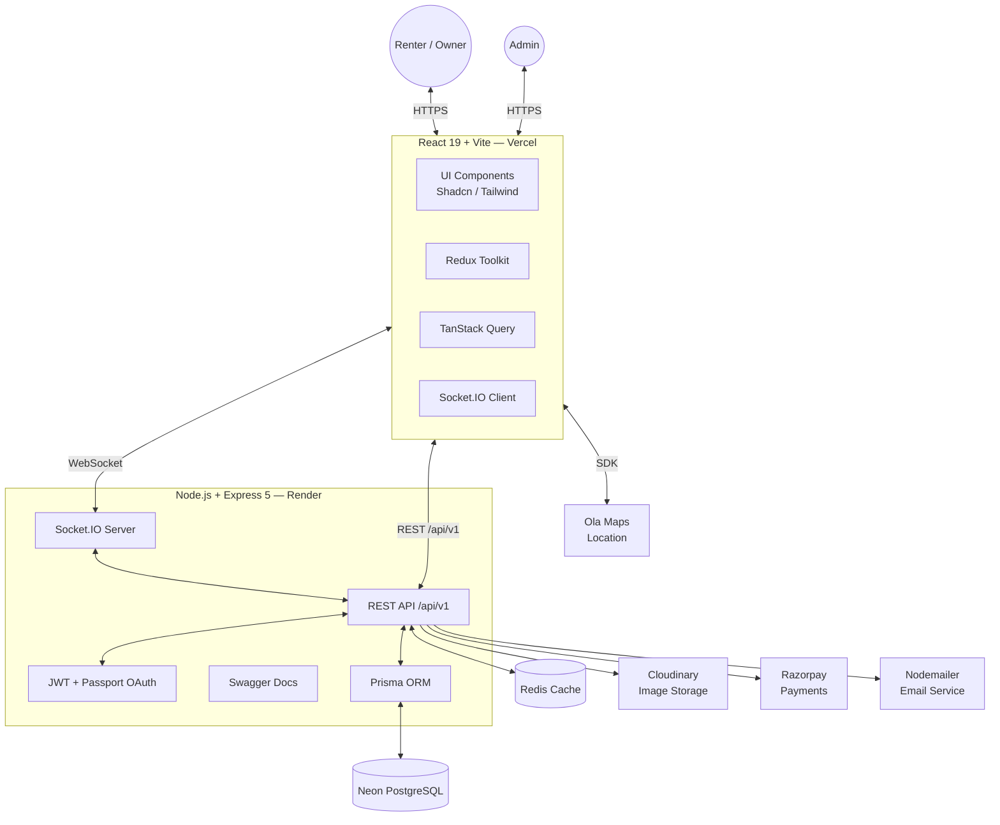
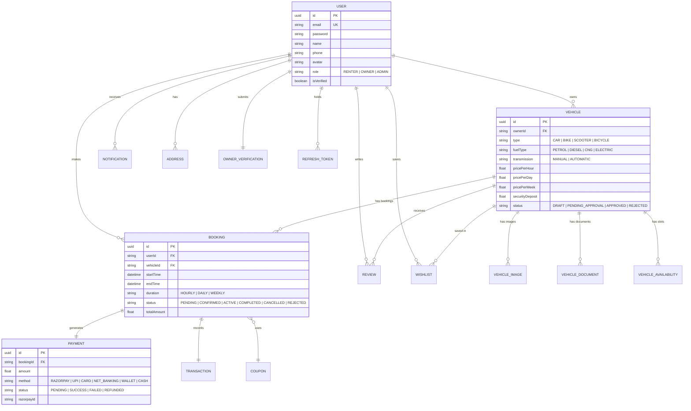
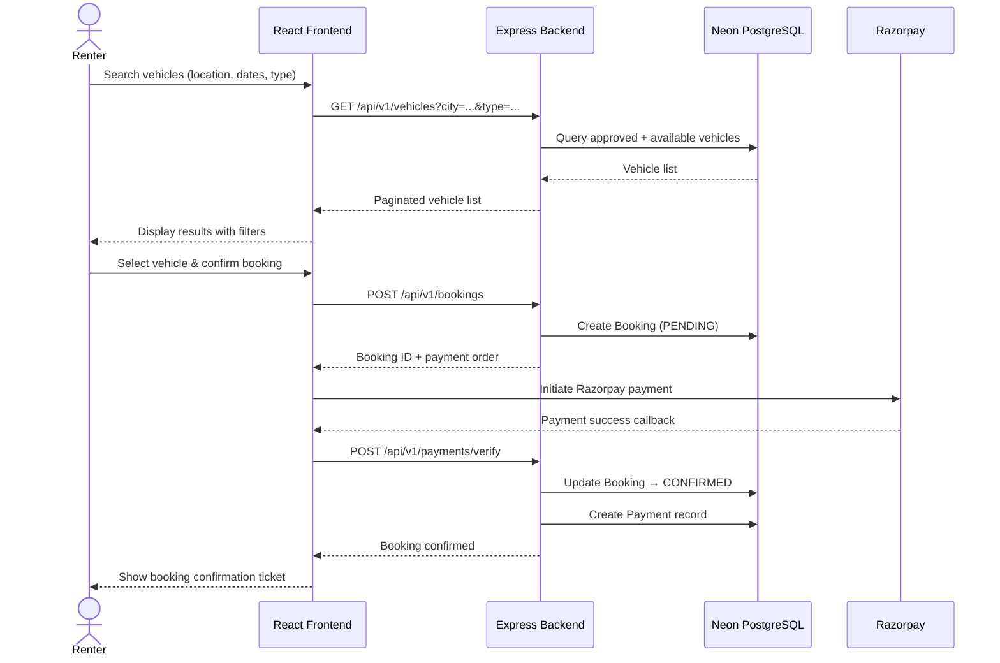
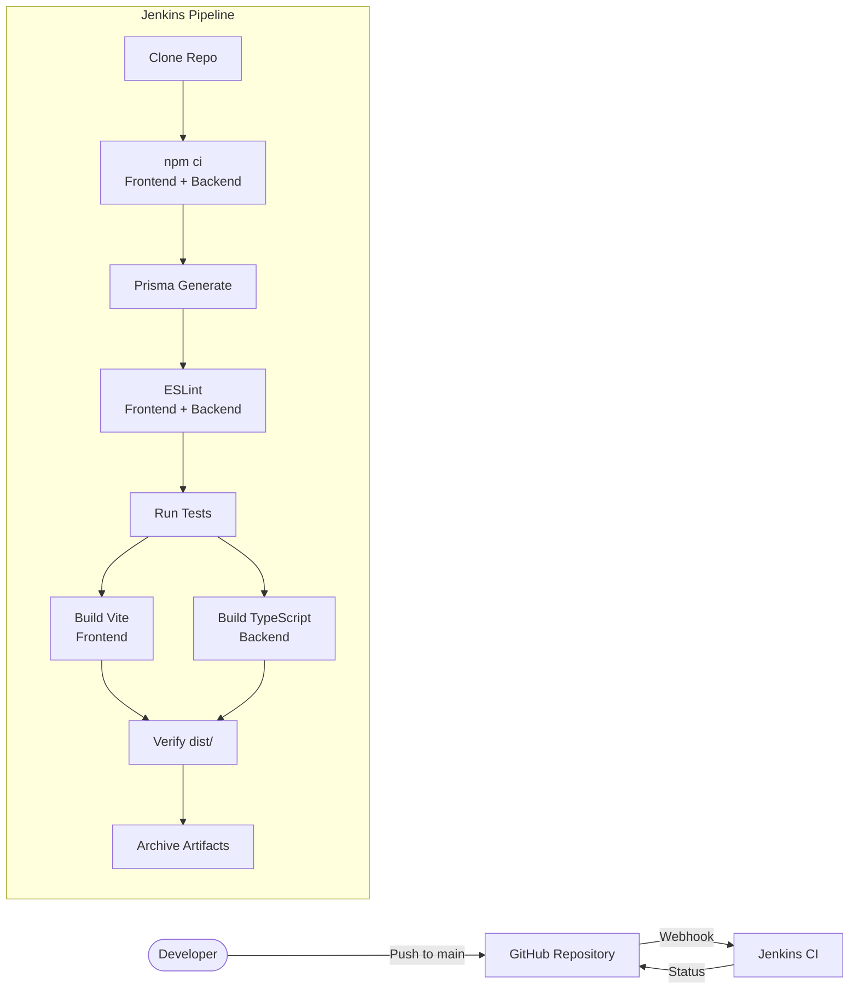

# 🚗 CarBoom

<div align="center">

**CarBoom** is a modern **peer-to-peer vehicle rental marketplace** that enables users to rent and list Cars, Bikes, Scooters, Bicycles & EVs — for durations ranging from **1 hour to 1 week**. Built for **Tier-2 and Tier-3 cities in India**.

[](https://github.com/Piyush200516/CarBoom)
[](https://opensource.org/licenses/MIT)
[](https://nodejs.org)
[](https://react.dev)
[](https://neon.tech)

</div>

---

## 🚀 What is CarBoom?

CarBoom is a next-generation **peer-to-peer vehicle rental platform** where:

- 🚗 **Renters** can search, browse, and instantly book vehicles.
- 🏠 **Owners** can list their vehicles, manage availability, and earn passive income.
- 🛡️ **Admins** can verify owners, approve vehicles, and manage the entire ecosystem.

### ✨ Key Highlights

| Feature | Description |
|---|---|
| 🤖 AI Recommendations | Smart vehicle suggestions based on preferences |
| 📍 Location Services | Ola Maps integration for pickup & drop |
| 🔐 Auth & RBAC | JWT + Refresh Token auth with role-based access |
| 💳 Payments | Razorpay with coupon & discount support |
| ⭐ Reviews & Ratings | User reviews per vehicle |
| ❤️ Wishlist | Save favourite vehicles |
| 📅 Real-Time Booking | Instant availability checks |
| 📊 Owner Dashboard | Revenue analytics & booking management |
| 🔔 Notifications | Real-time notification system |
| 🔑 OAuth | Google & GitHub social login |
| 📧 Email | Nodemailer for transactional emails |
| 🛡️ Security | Helmet, Rate Limiting, Audit Logs |
| 📄 API Docs | Swagger / OpenAPI documentation |
| 📱 Responsive UI | Fully responsive with dark mode support |

---

## 🛠️ Tech Stack

### Frontend (`/client`)

| Technology | Purpose |
|---|---|
| React 19 + TypeScript | Core UI framework |
| Vite 8 | Build tool & dev server |
| Tailwind CSS v4 | Utility-first styling |
| Shadcn UI + Base UI | Pre-built component library |
| React Router DOM v7 | Client-side routing |
| Redux Toolkit | Global state management |
| TanStack Query v5 | Server state & data fetching |
| React Hook Form + Zod | Form handling & validation |
| Framer Motion | Animations & transitions |
| Axios | HTTP client |
| Lucide React | Icon library |
| Sonner / React Hot Toast | Toast notifications |
| next-themes | Dark / Light mode |
| Socket.IO Client | Real-time communication |
| Dayjs | Date utilities |

### Backend (`/server`)

| Technology | Purpose |
|---|---|
| Node.js + Express 5 | REST API server |
| TypeScript | Type-safe backend |
| Prisma ORM | Database access layer |
| Neon PostgreSQL | Serverless PostgreSQL database |
| Redis | Caching & session store |
| Socket.IO | Real-time WebSocket server |
| JWT (Access + Refresh) | Authentication tokens |
| Passport.js | Google & GitHub OAuth |
| Cloudinary | Image & document storage |
| Razorpay | Payment gateway |
| Nodemailer | Transactional email |
| Multer | File upload handling |
| Winston | Structured logging |
| Morgan | HTTP request logging |
| Helmet | HTTP security headers |
| express-rate-limit | Rate limiting |
| Swagger | API documentation (`/api-docs`) |
| Zod | Request validation |

---

## 📊 System Architecture

### 1. High-Level Architecture



### 2. Database Entity Relationship (ER) Diagram



### 3. Vehicle Booking Flow



### 4. Jenkins CI/CD Pipeline



---

## 📁 Project Structure

```text
CarBoom/
├── client/                         # React 19 + Vite Frontend
│   ├── src/
│   │   ├── components/             # Reusable UI components
│   │   │   └── ui/                 # Shadcn-based component library
│   │   ├── pages/                  # Application pages
│   │   │   ├── Home/
│   │   │   ├── BrowseVehicles/
│   │   │   ├── VehicleDetails/
│   │   │   ├── Checkout/
│   │   │   ├── Payment/
│   │   │   ├── BookingConfirmation/
│   │   │   ├── Dashboard/
│   │   │   ├── Profile/
│   │   │   ├── BecomeOwner/
│   │   │   ├── Login/ & Signup/
│   │   │   ├── ForgotPassword/ & ResetPassword/
│   │   │   ├── HowItWorks/
│   │   │   ├── AboutUs/ & Contact/
│   │   │   ├── HelpCenter/
│   │   │   ├── Safety/ & Privacy/ & Terms/
│   │   │   ├── CancellationPolicy/
│   │   │   └── NotFound/
│   │   ├── services/               # Axios API service layer
│   │   ├── store/                  # Redux Toolkit slices
│   │   ├── router/                 # React Router configuration
│   │   ├── layouts/                # Page layout wrappers
│   │   ├── constants/              # App-wide constants
│   │   ├── utils/                  # Helper utilities
│   │   └── data/                   # Static/mock data
│   ├── public/
│   ├── vite.config.ts
│   └── package.json
│
├── server/                         # Node.js + Express 5 Backend
│   ├── src/
│   │   ├── controllers/            # Request handlers
│   │   │   ├── auth.controller.ts
│   │   │   ├── user.controller.ts
│   │   │   ├── vehicle.controller.ts
│   │   │   ├── booking.controller.ts
│   │   │   ├── payment.controller.ts
│   │   │   ├── review.controller.ts
│   │   │   └── notification.controller.ts
│   │   ├── routes/                 # Express route definitions
│   │   │   ├── auth.routes.ts
│   │   │   ├── user.routes.ts
│   │   │   ├── vehicle.routes.ts
│   │   │   ├── booking.routes.ts
│   │   │   └── index.ts
│   │   ├── repositories/           # Data access layer (Prisma queries)
│   │   ├── services/               # Business logic layer
│   │   ├── middleware/             # Auth, rate-limit, error, validation
│   │   ├── validators/             # Zod schemas
│   │   ├── config/                 # Config, Logger setup
│   │   ├── lib/                    # Shared lib (Prisma client, Redis, etc.)
│   │   ├── types/                  # TypeScript type definitions
│   │   ├── utils/                  # Helpers (ApiError, ApiResponse)
│   │   ├── constants/              # Server-side constants
│   │   ├── app.ts                  # Express app setup
│   │   └── server.ts               # Server entry point
│   ├── prisma/
│   │   ├── schema.prisma           # Database schema
│   │   └── migrations/             # Prisma migration history
│   └── package.json
│
├── Jenkinsfile                     # CI/CD Pipeline definition
└── README.md
```

---

## 🔌 API Reference

Base URL (Local): `http://localhost:5000/api/v1`  
Base URL (Production): `https://carboom-backend.onrender.com/api/v1`  
API Docs (Swagger): `http://localhost:5000/api-docs`

### Auth Routes — `/api/v1/auth`

| Method | Endpoint | Auth | Description |
|--------|----------|------|-------------|
| `POST` | `/register` | ❌ | Register a new user |
| `POST` | `/login` | ❌ | Login (rate-limited) |
| `POST` | `/logout` | ❌ | Logout & clear refresh token |
| `POST` | `/refresh` | ❌ | Refresh access token |
| `GET` | `/me` | ✅ | Get current user profile |
| `POST` | `/change-password` | ✅ | Change user password |

### Vehicle Routes — `/api/v1/vehicles`

| Method | Endpoint | Auth | Role | Description |
|--------|----------|------|------|-------------|
| `GET` | `/` | ❌ | Any | Browse / search vehicles |
| `GET` | `/:id` | ❌ | Any | Get vehicle by ID |
| `POST` | `/` | ✅ | OWNER, ADMIN | List a new vehicle |
| `GET` | `/owner/me` | ✅ | OWNER | Get own vehicles |
| `PUT` | `/:id` | ✅ | OWNER, ADMIN | Update vehicle |
| `DELETE` | `/:id` | ✅ | OWNER, ADMIN | Delete vehicle |
| `POST` | `/:id/images` | ✅ | OWNER, ADMIN | Upload vehicle images |
| `DELETE` | `/images/:imageId` | ✅ | OWNER | Delete vehicle image |
| `POST` | `/:id/documents` | ✅ | OWNER, ADMIN | Upload vehicle documents |
| `DELETE` | `/documents/:docId` | ✅ | OWNER | Delete vehicle document |

### Booking Routes — `/api/v1/bookings`

| Method | Endpoint | Auth | Description |
|--------|----------|------|-------------|
| `POST` | `/` | ✅ | Create a booking |
| `GET` | `/my` | ✅ | Get renter's bookings |
| `GET` | `/owner` | ✅ | Get owner's received bookings |
| `PATCH` | `/:id/cancel` | ✅ | Cancel a booking |

### User Routes — `/api/v1/users`

| Method | Endpoint | Auth | Description |
|--------|----------|------|-------------|
| `GET` | `/profile` | ✅ | Get user profile |
| `PATCH` | `/profile` | ✅ | Update user profile |
| `POST` | `/avatar` | ✅ | Upload profile avatar |

---

## 🚀 Getting Started

### Prerequisites

- Node.js `>= 20.x`
- npm `>= 10.x`
- PostgreSQL (or a [Neon](https://neon.tech) account)
- Redis (local or cloud instance)

### Clone the Repository

```bash
git clone https://github.com/Piyush200516/CarBoom.git
cd CarBoom
```

---

## 🌐 Frontend Setup

### 1. Install dependencies

```bash
cd client
npm install
```

### 2. Configure environment

Create a `client/.env` file (or leave it empty for local dev — the Vite proxy handles API calls automatically):

```env
# Leave unset to use the Vite dev proxy (recommended for local dev)
# VITE_API_URL=https://carboom-backend.onrender.com/api/v1
```

### 3. Start the dev server

```bash
npm run dev
```

Frontend runs at: **`http://localhost:5173`**

---

## 🖥️ Backend Setup

### 1. Install dependencies

```bash
cd server
npm install
```

### 2. Configure environment

Create a `server/.env` file:

```env
PORT=5000
NODE_ENV=development

# Neon PostgreSQL
DATABASE_URL="postgresql://<user>:<password>@<host>/neondb?sslmode=require"

# JWT
JWT_ACCESS_SECRET="your-strong-access-secret"
JWT_REFRESH_SECRET="your-strong-refresh-secret"
JWT_ACCESS_EXPIRY="15m"
JWT_REFRESH_EXPIRY="7d"

# CORS (comma-separated origins or * for all)
CORS_ORIGIN="http://localhost:5173"

# Redis
REDIS_HOST=localhost
REDIS_PORT=6379
REDIS_PASSWORD=

# Cloudinary
CLOUDINARY_CLOUD_NAME=
CLOUDINARY_API_KEY=
CLOUDINARY_API_SECRET=

# Razorpay
RAZORPAY_KEY_ID=
RAZORPAY_KEY_SECRET=

# Google OAuth
GOOGLE_CLIENT_ID=
GOOGLE_CLIENT_SECRET=

# GitHub OAuth
GITHUB_CLIENT_ID=
GITHUB_CLIENT_SECRET=
```

### 3. Run database migrations

```bash
npm run prisma:generate
npm run prisma:migrate
```

### 4. Start the dev server

```bash
npm run dev
```

Backend runs at: **`http://localhost:5000`**  
Swagger Docs: **`http://localhost:5000/api-docs`**

---

## 🏗️ Jenkins CI Setup

### Required Jenkins Plugins
- **Pipeline**
- **Git**
- **Credentials Binding**
- **NodeJS** *(optional — for automatic Node installation)*
- **AnsiColor**

### Credentials to Create
> Jenkins → Manage Jenkins → Credentials → System → Global

| Credential ID | Type | Description |
|---|---|---|
| `neon-db-url` | Secret text | Neon PostgreSQL connection string |
| `jwt-secret` | Secret text | JWT signing secret |

### GitHub Webhook

1. Go to your repo → **Settings → Webhooks → Add webhook**
2. **Payload URL**: `http://<JENKINS_HOST>/github-webhook/`
3. **Content type**: `application/json`
4. **Trigger**: Just the push event
5. Save

### Jenkins Job Setup

1. **New Item → Pipeline** → Name it `CarBoom CI`
2. **Pipeline → Definition**: Pipeline script from SCM
   - SCM: Git
   - Repository URL: `https://github.com/Piyush200516/CarBoom.git`
   - Branch: `*/main`
   - Script Path: `Jenkinsfile`
3. Enable **GitHub hook trigger for GITScm polling**
4. Save

### Pipeline Stages

| Stage | Description |
|---|---|
| Clone Repository | Checks out the `main` branch |
| Install Dependencies | `npm ci` for client & server (parallel) |
| Prisma Generate | `npx prisma generate` |
| Lint | ESLint for client & server (parallel) |
| Test | Runs test scripts if present |
| Build Frontend | `npm run build` (Vite) |
| Build Backend | `npm run build` (TypeScript → JS) |
| Verify Build Success | Sanity check for `dist/` directories |
| Archive Artifacts | Archives `client/dist/**` & `server/dist/**` |

---

## ✅ Features & Roadmap

### Renter
- [x] Browse & search vehicles (location, type, fuel, price, transmission)
- [x] Vehicle detail page
- [x] Checkout & booking flow
- [x] Razorpay payment integration
- [x] Booking confirmation
- [x] Booking history (Dashboard)
- [x] Wishlist / Favourites
- [x] Ratings & Reviews
- [x] User profile management
- [x] Forgot / Reset password flow

### Owner
- [x] List & manage vehicles
- [x] Upload vehicle images & documents
- [x] Manage bookings
- [x] Owner verification submission
- [x] Revenue analytics (Dashboard)

### Admin
- [x] User management
- [x] Owner verification workflow
- [x] Vehicle approval pipeline
- [x] Audit logs

### Platform
- [x] JWT + Refresh Token authentication
- [x] Google & GitHub OAuth
- [x] Role-Based Access Control (RENTER / OWNER / ADMIN)
- [x] Real-time notifications (Socket.IO)
- [x] Rate limiting & Helmet security headers
- [x] Structured logging (Winston + Morgan)
- [x] Swagger API documentation
- [x] Redis caching
- [x] Jenkins CI/CD pipeline
- [x] Deployed on Vercel (frontend) + Render (backend)
- [ ] AI-based vehicle recommendations
- [ ] Live vehicle tracking
- [ ] Chat / messaging system
- [ ] Dynamic pricing
- [ ] Insurance integration
- [ ] EV Charging Station Finder
- [ ] Mobile app (Android & iOS)
- [ ] Multi-language support
- [ ] Referral & Rewards program

---

## 🤝 Contributing

Contributions are welcome!

1. Fork the repository
2. Create your feature branch
   ```bash
   git checkout -b feature/your-feature-name
   ```
3. Commit your changes
   ```bash
   git commit -m "feat: add your feature"
   ```
4. Push the branch
   ```bash
   git push origin feature/your-feature-name
   ```
5. Open a Pull Request

---

## 📄 License

This project is licensed under the **MIT License** — see the [LICENSE](LICENSE) file for details.

---

## 👤 Author

**Piyush Mishra**

- GitHub: [github.com/Piyush200516](https://github.com/Piyush200516)
- LinkedIn: [linkedin.com/in/piyush-mishra](https://linkedin.com/in/piyush-mishra)

---

## 🎯 Vision

To build India's most trusted and intelligent vehicle rental platform — empowering local vehicle owners in Tier-2 and Tier-3 cities to earn by sharing their vehicles, while giving renters the most affordable and reliable mobility options available.

---

<div align="center">
  If you like this project, don't forget to <strong>⭐ Star the repository</strong>!
</div>